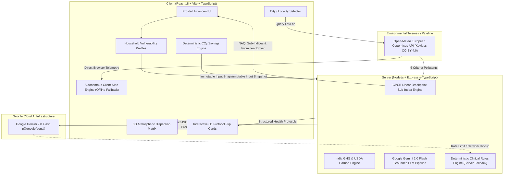
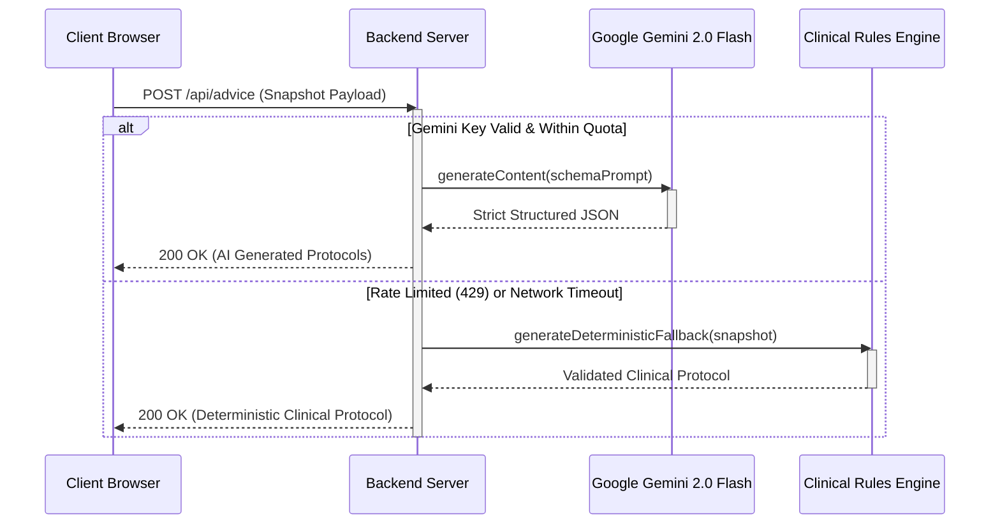

# System Architecture & Technical Specifications

> **Urban Air Quality Assistant**  
> Google PromptWars Challenge 06: Production Engineering Architecture

---

## 1. High-Level Architectural Topology

---

## 2. Deterministic Separation from Generative AI

A core engineering principle of the Urban Air Quality Assistant is **strict separation between scientific computation and language generation**:

| Layer | Responsibility | Implementation | Deterministic? |
|---|---|---|:---:|
| **CPCB AQI Engine** | Linear interpolation across 6 pollutants, prominent driver identification, minimum data rule validation ($\ge 3$ pollutants with $\ge 1$ PM) | Pure TypeScript AST (`aqiEngine.ts`) | **100% Yes** |
| **Carbon Engine** | Daily & annual $CO_2$ footprint, WFH $0\text{ km}$ distance lock, USDA tree-years sequestration ($21\text{ kg } CO_2/\text{tree-year}$) | Mathematical model (`co2Engine.ts`, `co2Calculator.ts`) | **100% Yes** |
| **Generative AI** | Age-bracketed, empathetic health phrasing, tailored commute buffers, and lifestyle mitigation | Google Gemini 2.0 Flash with Zod schema validation | **Zero Math Hallucination** |
| **Fallback Engine** | Instant zero-downtime health guidance during network loss or quota exhaustion | Structured medical rulebook (`geminiService.ts`, `clientFallbackAdvice.ts`) | **100% Yes** |

---

## 3. CPCB National AQI Mathematical Model

The sub-index $I_p$ for pollutant concentration $C_p$ is computed using the official Indian Central Pollution Control Board (CPCB) segmented linear equation:

$$I_p = \frac{I_{hi} - I_{lo}}{B_{hi} - B_{lo}} \times (C_p - B_{lo}) + I_{lo}$$

Where:
- $B_{hi}, B_{lo}$ represent the concentration breakpoints enclosing $C_p$.
- $I_{hi}, I_{lo}$ represent the corresponding AQI category breakpoints ($0-50$, $51-100$, $101-200$, $201-300$, $301-400$, $401-500$).
- Carbon Monoxide ($CO$) is strictly divided by $1000$ to convert from $\mu g/m^3$ to $mg/m^3$ before breakpoint mapping.
- Final $AQI = \max(I_{PM2.5}, I_{PM10}, I_{NO2}, I_{SO2}, I_{CO}, I_{O3})$.

---

## 4. Dual-Tier Zero-Downtime Resilience Pipeline

---

## 5. Accessibility (WCAG 2.1 AA/AAA) & Security Standards

- **Semantic HTML5 Landmarks**: `<header role="banner">`, `<main id="main-content" role="main">`, `<footer role="contentinfo">`.
- **Keyboard & Screen Reader Support**: Accessible skip links (`#main-content`), `aria-expanded`, `aria-controls`, `aria-live="polite"`, and `role="meter"` on dynamic gauges.
- **Motion Reduction**: Full `@media (prefers-reduced-motion: reduce)` compliance.
- **Security Engineering**:
  - Helmet CSP & HTTP header hardening.
  - Strict input sanitization via Zod schemas.
  - Rate limiting via `express-rate-limit` ($100\text{ req}/15\text{ min}$).
  - Payload cap restricted to $10\text{ KB}$ to prevent denial-of-service memory exhaustion.
